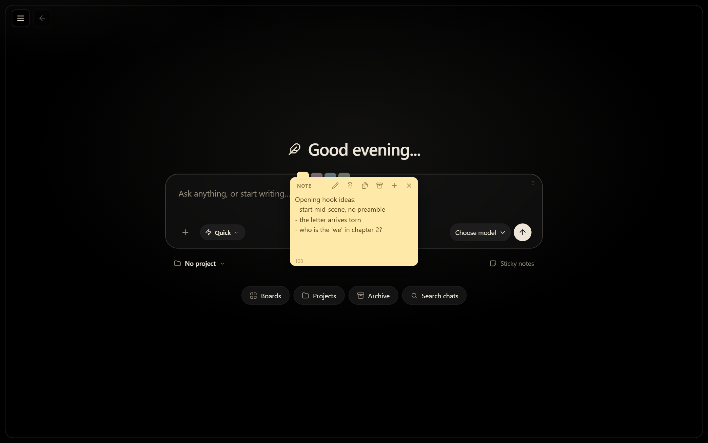
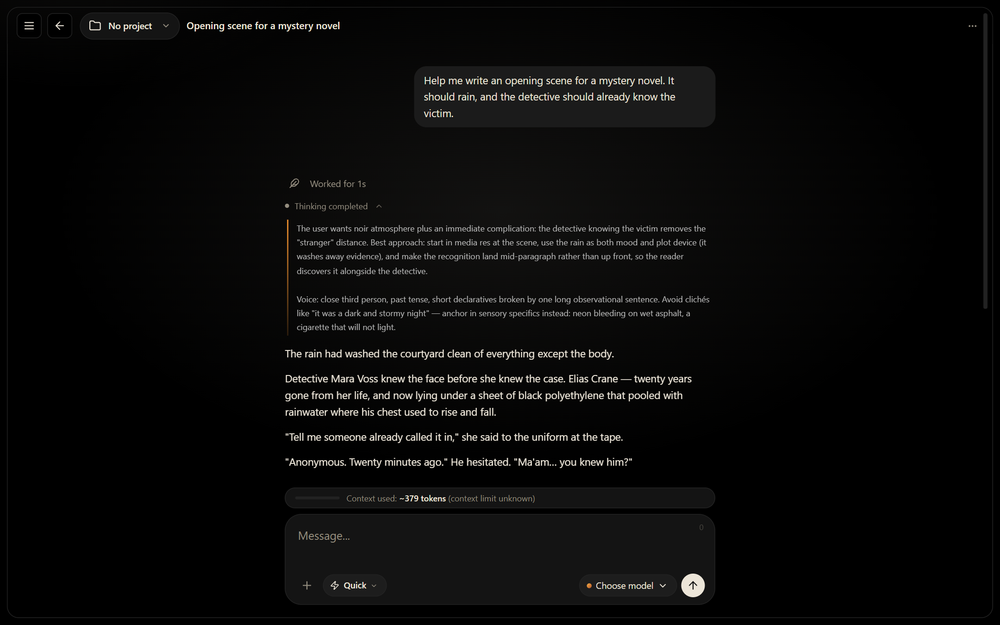
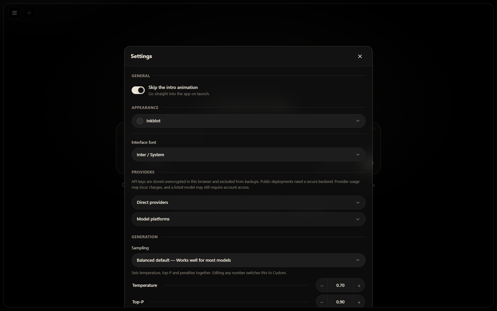

# Prosaic

A local writing playground for your own AI models.

Prosaic talks directly to AI providers using **your own API keys**. No subscription,
no middleman, no server in the middle: your keys, your machine, your words.

Bring a key from OpenAI, Anthropic, Google, OpenRouter, Amazon Bedrock, Groq,
Mistral, Ollama — or any OpenAI-compatible endpoint — and start writing.

## Screenshots

## Why Prosaic

- **Bring your own key** — connect providers with your own API keys and pay them
  directly for what you use, nothing more
- **Private by design** — everything runs and stores locally on your machine
- **Built for writing** — chats, projects, sticky notes, and boards for plotting,
  with thinking blocks for models that reason
- **Two ways to run it** — a single HTML file, or a desktop app for Windows

## Getting started

**Desktop app (Windows):** download `Prosaic-Setup-1.0.0.exe` from
[Releases](https://github.com/shoddy-share/prosaic/releases) and run it.

**Single HTML file:** download `app/prosaic.html` and open it in any modern browser.

Then:

1. Open **Settings**
2. Add a provider and paste your API key
3. Pick a model, set the temperature if you like, and write

## Features

- Multi-provider support: OpenAI, Anthropic, Google, OpenRouter, Amazon Bedrock,
  Groq, Mistral, Ollama, and any OpenAI-compatible endpoint
- Thinking / reasoning blocks on models that support them
- Per-model temperature and sampling controls
- Streaming responses
- Projects to organize chats
- Sticky notes and boards for planning
- Multiple themes
- Export chats as Markdown

## Privacy

Your API keys and everything you write stay on your machine. Prosaic sends requests
straight to the providers you connect — no telemetry, no analytics, no accounts.

## License

MIT
